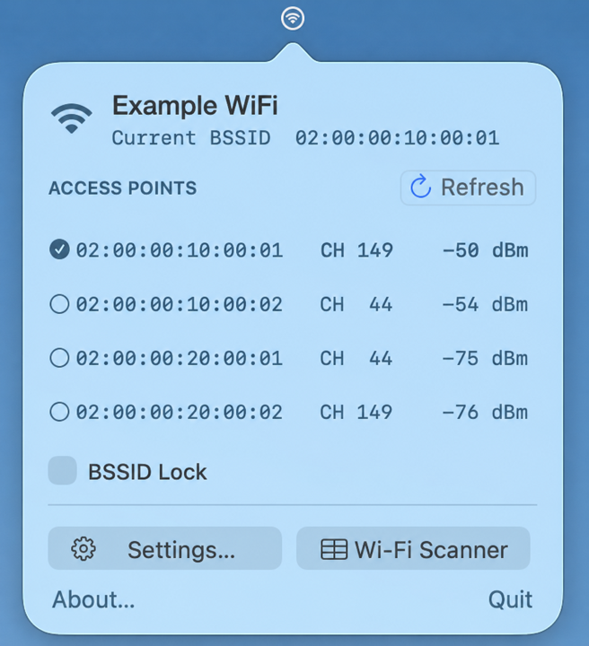

# BSSID Picker

BSSID Picker is a macOS menu-bar app for viewing the access points (BSSIDs)
advertising your current Wi-Fi network. It asks macOS to associate with the
access point you select and verifies which BSSID the Mac actually joined.

The included Wi-Fi Scanner provides a detailed view of nearby networks,
selectable diagnostics, search and filters, cached observations, and JSON or
CSV export.



## Features

- Lists the BSSIDs for the current Wi-Fi network with channel, signal strength,
  and the currently associated access point.
- Requests and verifies association with a selected BSSID.
- Optionally monitors a saved target with **BSSID Lock** and provides inline
  recovery actions when macOS roams or a connection fails.
- Scans nearby networks and decodes their advertised radio, security, roaming,
  topology, and information-element data.
- Optionally resolves MAC-address registrants from a locally stored database;
  updates download complete source files and never submit scanned BSSIDs.
- Supports literal or regular-expression search, filters, configurable columns,
  observation retention, selectable text, and export.
- Can launch the menu-bar app at login. The Scanner remains closed until opened
  explicitly.

## Important limitation

macOS controls final access-point selection and roaming. Standard mode uses
public CoreWLAN and cannot guarantee a permanent BSSID pin. An association
request can interrupt Wi-Fi and still finish on another access point that uses
the same SSID.

Experimental Strict BSSID is enabled by default and uses undocumented private
CoreWiFi interfaces. It never silently falls back to Standard mode, may stop
working after any macOS update, and is not suitable for safety-critical
connectivity. Disable it in Settings to use Standard CoreWLAN association. See
[BSSID Association on macOS](docs/BSSID-ASSOCIATION.md) for the detailed API
analysis and historical findings.

## Requirements

- macOS 13 or later.
- An Intel or Apple silicon Mac.
- Location permission at runtime so macOS can expose protected SSID and BSSID
  information.

Building from source additionally requires Xcode or Xcode Command Line Tools
with Swift, Clang, `xcrun`, and a macOS SDK, plus a normal non-root account with
a login Keychain. An Apple Developer Program membership is not required for a
personal local build.

## Download

When a versioned [GitHub Release](https://github.com/atlantos/macosx-bssid-picker/releases)
is published, it provides separate native archives for Apple silicon
(`arm64`) and Intel (`x86_64`) Macs. Run `uname -m` in Terminal if you are
unsure which architecture to download.

Release applications are ad-hoc signed so their Sandbox entitlements and
bundle integrity can be validated, but they are not Developer ID-signed or
notarized by Apple. macOS therefore requires an explicit **Open Anyway**
override. An ad-hoc identity also changes with the executable, so an update can
repeat Location or Keychain approval and can ask for access to the existing app
container. See [Installing a GitHub release](docs/INSTALLATION.md#installing-a-github-release)
for the installation steps and full limitations.

## Build and install

Run from the repository root:

```sh
./BuildTools/setup-local-signing.sh
./BuildTools/build-app.sh
open "build/BSSID Picker.app"
```

The signing setup is normally required once per Mac. It creates a local
self-signed Code Signing identity in the login Keychain so Location and
Keychain approvals remain stable across rebuilds. During setup, macOS asks for
the login-Keychain password in Terminal and presents a native trust approval.
The password is handled by Apple's tool and is not stored by the script. Do not
run the setup with `sudo`.

The build produces a self-contained app at `build/BSSID Picker.app`; it does
not run an installer. You can use it there or copy it to **Applications**. For a
stable Launch at Login path, copy it before enabling that setting and launch
the installed copy. A later rebuild updates only the copy under `build/`, so
replace the installed copy when updating it.

For signing recovery, alternate identities, ad-hoc diagnostic builds, and the
security model, see [Installation and Local Signing](docs/INSTALLATION.md).
Building locally with the persistent identity is preferable when permission
continuity across rebuilds matters. Normal Gatekeeper-trusted public
distribution would require Developer ID signing and notarization; the GitHub
release archives intentionally do not use that distribution path.

## First launch

1. Open the Wi-Fi target icon in the menu bar and choose **Settings…**.
2. Under **Location Access**, choose **Request Access** and approve the macOS
   prompt.
3. Optionally choose **Download Database** under **MAC Registrant Database** to
   enable local registrant lookup in Wi-Fi Scanner.
4. Return to the menu, refresh, and select a BSSID.
5. Optionally enable **BSSID Lock** after selecting the target.
6. Open **Wi-Fi Scanner** for the full nearby-network view.
7. Optionally enable **Launch BSSID Picker at login** in Settings.

BSSID Picker normally has no Dock icon. A Dock icon and conventional app menu
appear while the Wi-Fi Scanner session is open; closing the Scanner returns the
app to menu-bar-only mode.

## Network compatibility

Standard mode can connect to passwordless networks and to saved Personal or
legacy WEP networks. Strict mode supports passwordless networks and compatible
saved Personal PSK networks. Enterprise/802.1X and unknown or ambiguous
authentication are available for inspection but are not associated through an
inappropriate credential flow.

## Privacy

BSSID Picker runs inside Apple's App Sandbox. Its file access is limited to its
own container and export destinations explicitly chosen in the system Save
dialog. Outgoing networking is used only for user-initiated downloads of the
complete MAC registrant source files; the app accepts no incoming connections.

macOS treats nearby SSIDs and BSSIDs as Location-protected information. BSSID
Picker requests Location access only from the explicit Settings action and
does not request geographic coordinates.

Standard association may read an SSID-scoped saved Personal or WEP password.
System Keychain fallback requires explicit consent. The app does not log or
persist the password. For compatible saved Personal PSK networks, Strict mode
delegates credential resolution to macOS and does not receive the password.
Scanning, opening Wi-Fi Scanner, copying, and exporting do not read Wi-Fi
passwords.

MAC registrant updates download complete public data files from Wireshark. The
app resolves scanned BSSIDs against its local copy and does not send a BSSID or
MAC prefix to an online lookup service.

Exports can contain nearby SSIDs, BSSIDs, hardware addresses, and raw Wi-Fi
advertisement data. Treat exported files as potentially sensitive and review
them before sharing.

## Documentation

- [User Guide](docs/USER-GUIDE.md) — menu workflow, Settings, BSSID Lock, retry
  behavior, and permissions.
- [Wi-Fi Scanner](docs/WIFI-SCANNER.md) — Scanner controls, search, filters,
  observation retention, inspector, copying, and export.
- [Installation and Local Signing](docs/INSTALLATION.md) — detailed setup,
  recovery, build, and signing guidance.
- [BSSID Association on macOS](docs/BSSID-ASSOCIATION.md) — public CoreWLAN,
  experimental CoreWiFi, Keychain boundaries, and historical evidence.
- [MAC Registrant Data Sources and Licenses](docs/MAC-REGISTRANT-DATA.md) —
  lookup meaning, update privacy, source provenance, and third-party licenses.
- [Architecture](docs/ARCHITECTURE.md) — developer-facing source layout and
  runtime boundaries.

## License

Unless otherwise noted, BSSID Picker's source code, documentation, and
project-owned assets are licensed under the
[GNU General Public License v3.0 only](LICENSE) (`GPL-3.0-only`).

The optional MAC registrant database is downloaded from third parties and
remains subject to the source projects' own licenses. See
[MAC Registrant Data Sources and Licenses](docs/MAC-REGISTRANT-DATA.md) for
details.
